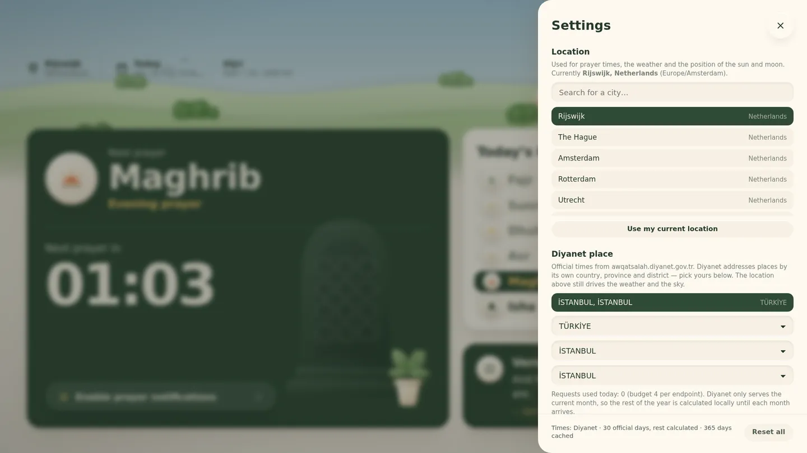

# Mektep Prayer

A 1920×1080 prayer-times display: today's times and a live countdown to the
next prayer, over a claymorphic landscape that follows the real sun, moon and
weather for the configured city.


| | |
| --- | --- |
|  |  |
|  |  |

Built with Next.js (App Router) and no UI framework — the clay look is a small
set of CSS custom properties and shadows in `app/globals.css`. Type is
[Plus Jakarta Sans](https://fonts.google.com/specimen/Plus+Jakarta+Sans) with
[Amiri](https://fonts.google.com/specimen/Amiri) for the Arabic watermark, both
self-hosted from npm so the Docker build never reaches for Google Fonts.

## Running it

```bash
npm install
npm run dev          # http://localhost:3000
```

That is the whole setup. No API keys, no accounts, no environment variables:
the default upstream services are keyless, and if neither can be reached the
app falls back to calculating the times itself and says so on screen.

With Docker:

```bash
cp .env.example .env          # optional — add Diyanet credentials here
docker compose -f docker-compose.standalone.yml up -d --build
```

For **Coolify**, see [Deploying](#deploying).

```bash
npm run build && npm start   # production
npm run typecheck            # tsc --noEmit
npm run scene                # re-render the artwork (see "Artwork")
```

Point a browser at it full-screen on a 16:9 display and it is a wall panel. The
layout is authored at 1920×1080 and scales as one piece to any resolution;
below 1000px wide it stacks into a phone layout. Times are shown on a 24-hour
clock.

## Where the data comes from

| What | Source | Notes |
| --- | --- | --- |
| Prayer times (preferred) | [Diyanet](https://awqatsalah.diyanet.gov.tr) `/api/PrayerTime/Monthly/{cityId}` | Needs an account. Official times, one month at a time — see below. |
| Prayer times (default) | [Aladhan](https://aladhan.com/prayer-times-api) `/calendar/{year}?annual=true` | Keyless. Method 13 is Diyanet İşleri Başkanlığı. |
| Weather | [Open-Meteo](https://open-meteo.com) `/v1/forecast` | Keyless. Current conditions, WMO code. |
| City search | Open-Meteo geocoding | Keyless. Falls back to a bundled list of ~28 cities offline. |

**The yearly calendar is fetched once.** One request covers all 365 days for a
location; the response is cached on disk under `.cache/prayer/` and reused for
the rest of the year. Changing the location or the calculation method fetches a
new year; changing an offset does not, because offsets are applied client-side.

Every base URL can be overridden if you proxy them:

```bash
DIYANET_BASE_URL=https://awqatsalah.diyanet.gov.tr
ALADHAN_BASE_URL=https://api.aladhan.com/v1
OPEN_METEO_BASE_URL=https://api.open-meteo.com/v1
OPEN_METEO_GEOCODING_URL=https://geocoding-api.open-meteo.com/v1
```

### If no API can be reached

`lib/solar.ts` computes the year locally from the sun's position, using the
Diyanet angles (Fajr 18°, Isha 17°, Asr shadow factor 1). The notice at the
bottom of the screen says `times calculated locally` whenever this is what you
are looking at, and the app retries on the next load. Spot-checked against
published tables it lands within a couple of minutes at Istanbul, Mecca,
Jakarta and Rijswijk.

Above roughly 48° latitude the sun never dips 18° below the horizon in
midsummer, so Fajr and Isha have no astronomical time — and for weeks either
side of that, the time it does have is minutes from solar midnight and unusable.
Both cases fall back to a fixed portion of the night (one seventh by default,
configurable in settings, matching Aladhan's `latitudeAdjustmentMethod`). The
rule only engages when a time is genuinely missing or lands within an eighth of
the night of solar midnight, so it leaves correct mid-latitude times alone.

## Diyanet

Put an account for [awqatsalah.diyanet.gov.tr](https://awqatsalah.diyanet.gov.tr)
in `.env`:

```bash
cp .env.example .env
# DIYANET_EMAIL=you@example.com
# DIYANET_PASSWORD=…
```

Restart, open the settings drawer, and a **Diyanet place** section appears.
Diyanet addresses places by its own ids, so pick Country → Province → District;
the location above it keeps driving the weather and the sky.



Check the credentials before trusting the screen:

```bash
npm run diyanet:check                  # log in, list countries
npm run diyanet:check -- --country 2   # provinces in Türkiye
npm run diyanet:check -- --state 539   # districts in that province
npm run diyanet:check -- --city 9541   # fetch a month, show it parsed
```

### Two constraints worth knowing before you rely on it

**There is no yearly endpoint.** The largest is `/api/PrayerTime/Monthly/{cityId}`,
and it takes no month parameter — it returns *the current month*. A year cannot
be fetched from Diyanet, however patient you are.

So the app accumulates. Each month's response is merged into a per-city store
under `.cache/prayer/diyanet-{cityId}.json`, and the rest of the year is filled
by the local calculation. A display left running collects the official month as
each one arrives. The settings footer says exactly what you are looking at:
`Diyanet · 30 official days, rest calculated`.

**The quota is small.** The documentation states five requests per day *per
endpoint* (counted per parameter value) for a Standard-role account, and says
plainly that integrators are expected to host the data themselves. The app is
built around that:

- Country, province and district lists are cached on disk permanently — first
  use only.
- The access token is cached on disk and refreshed via `/api/Auth/RefreshToken`
  rather than by logging in again.
- Prayer times are fetched only when the store no longer covers today, and at
  most once an hour.
- A counter refuses to spend more than `DIYANET_DAILY_BUDGET` (default 4, under
  the documented 5) per endpoint per day. When it trips, the display falls back
  to calculated times and the drawer says why.

Two things follow. **Keep `.cache` on a volume** — without it every restart
re-spends the day's allowance. And **run one replica**; the counter is per
process, so two instances sharing an account would each think they had a full
allowance.

## Settings

The gear at the top right opens a drawer. Everything is stored in
`localStorage` — there is no account and nothing leaves the browser.

- **Location** — city search, or the browser's geolocation. Drives prayer
  times, weather, and where the sun and moon sit in the sky.
- **Calculation method** — eight of Aladhan's methods; Diyanet is the default.
- **High latitude rule** — see above.
- **Time offsets** — ±60 minutes per prayer. This shifts the displayed time and
  delays the announcement with it, so `+5` on Dhuhr calls it five minutes after
  the calculated time.
- **Announced prayers** — the same switches as the speakers on the rows, for
  when a row is hard to reach on a wall display.
- **Appearance** — light/dark mode, 24-hour clock, weather on or off, and a
  reduce-motion switch that parks the animation.

### Light and dark

The interface turns **dark at Maghrib and light again at sunrise**. That is
deliberately tied to the prayer times, not to the sun's altitude: Maghrib is
the moment the day is over for the people reading the screen.

The toggle beside the gear pins it either way — a ring around the button means
the clock is no longer driving it. "Follow the sun" in the settings drawer
hands it back.

The sky is not part of that switch. It stays a continuous function of the sun's
real altitude, so just after Maghrib you get dark cards under a sky that is
still burning gold. Text that sits directly on the scene (the location and date
row) takes its colour from the sky rather than from the mode, so it stays
readable through that window.

## The call to prayer

The speaker on each prayer row toggles that prayer's announcement;
**shift-click it to hear the tone immediately** without waiting for the time.
When a prayer arrives the screen takes over with the prayer's name and the tone
plays. Browsers refuse to play audio before the page is interacted with, so the
**Enable prayer notifications** button on the countdown card unlocks it — press
it once when you set the display up.

The tone is synthesised in `lib/adhan.ts` (struck-bell partials arranged in
Hijaz), so no audio ships with the app. To use a real recording, drop
`adhan.mp3` into `public/audio/` — or `adhan-fajr.mp3` for a per-prayer call.
It is picked up on the next load with no configuration.

## The scene

`components/scene/SceneBackground.tsx` draws it, and everything in it is
driven by real values rather than a time-of-day preset:

- **Sky** — every sky colour is a continuous function of the sun's altitude
  (`lib/sky.ts`), interpolated between keyframes, so the landscape drifts from
  night through dawn to day with no visible switch. Dawn runs cool and pink,
  dusk runs amber. The interface palette is separate, and switches at Maghrib.
- **Sun and moon** — placed from real altitude and azimuth for the location.
  The moon carries its actual phase, carved out of the disc with a CSS mask.
  Both set behind the hills. The vertical arc is compressed into the strip of
  sky above the cards; the horizontal arc is centred right of screen centre to
  clear the logo.
- **Weather** — the WMO code from Open-Meteo picks cloud density, rain, sleet,
  snow, fog, and the lightning flash, and mutes the palette
  (`lib/weather.ts`). Clouds drift on independent slow loops.

## Artwork

The layers in `public/scene/` are transparent WebP, generated from SVG authored
in `scripts/scene-art.mjs`. Three things carry the clay look and are applied to
every form: a soft two-stop gradient, a blurred highlight where the light
falls, and a fine `feTurbulence` grain multiplied back over the shape — without
that last one the art reads as flat vector rather than matte felt.

```bash
npm run scene    # writes assets/scene/*.svg and public/scene/*.webp
```

The generated files are committed, so a fresh clone runs without this step —
re-run it after editing the art. To use your own renders instead, drop
replacements into `public/scene/` under the same names; the scene component only
knows about the filenames.

## Deploying

### Coolify

1. **New Resource → Docker Compose**, pointed at this repository. It picks up
   `docker-compose.yml`.
2. In **Environment Variables**, set `DIYANET_EMAIL` and `DIYANET_PASSWORD`
   (skip if you are staying on Aladhan).
3. Deploy. Coolify substitutes `SERVICE_FQDN_MEKTEP_3000` with the domain it
   assigns and routes its proxy to port 3000, so no host port is published.

The compose file declares a `prayer-cache` volume on `/app/.cache`. Leave it
in place: it holds the cached calendars, the Diyanet token and the quota
counter. Keep the replica count at 1.

`/api/health` backs both the container healthcheck and Coolify's.

### Plain Docker

```bash
cp .env.example .env
docker compose -f docker-compose.standalone.yml up -d --build
```

Publishes on `${PORT:-3000}`. The image is a multi-stage build on
`node:22-bookworm-slim` shipping Next's `standalone` output, and runs as a
non-root user.

## Layout

```
app/
  api/prayer-times/   the calendar: Diyanet → Aladhan → calculated
  api/diyanet/        place cascade and credential/quota status
  api/weather/        current conditions, 10-minute memory cache
  api/geocode/        city search with an offline fallback
  api/audio/          lists any adhan recordings you added
  api/health/         liveness probe
  globals.css         clay design system
  scene.css           the background and its animations
components/           header, cards, settings drawer, scene
lib/
  solar.ts            sun/moon position; offline prayer calculation
  sky.ts              altitude → sky; Maghrib → light/dark interface
  prayer.ts           schedule, next prayer, kerahat windows
  time.ts             timezone-correct conversion and formatting
  diyanet.ts          Diyanet auth, quota guard, place and time endpoints
  diyanet-calendar.ts the accumulating per-city month store
  calendar-source.ts  source selection, caching, local fallback
scripts/              the artwork build and the Diyanet credential check
```

## Known gaps

- One screen. There is no navigation and no other page.
- Kerahat windows are still computed in `lib/prayer.ts` (`schedule.kerahat`,
  the conventional 45-minute İşrak / İstiva / İsfirar windows) but nothing
  renders them — they are meant to be presented differently.
- Verse of the day rotates through 14 verses by day number.
