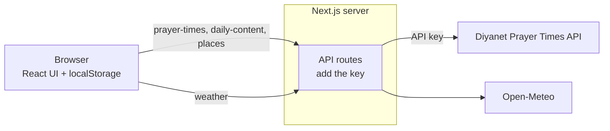

<div align="center">

# Prayer Times

**A wall-panel prayer-times display that watches the real sky.**

Today's times, a live countdown to the next prayer and the call to prayer, over a
claymorphic landscape that follows the actual sun, moon and weather of your city.


</div>

## Contents

- [What it does](#what-it-does)
- [Gallery](#gallery)
- [Quick start](#quick-start)
- [Getting API credentials](#getting-api-credentials)
- [Configuration](#configuration)
- [Run it as a wall panel](#run-it-as-a-wall-panel)
- [How it works](#how-it-works)
- [Settings](#settings)
- [The call to prayer](#the-call-to-prayer)
- [The scene](#the-scene)
- [Artwork](#artwork)
- [Project layout](#project-layout)
- [Tech stack](#tech-stack)
- [Known gaps](#known-gaps)
- [License](#license)

## What it does

| | |
| --- | --- |
| **Prayer times** | Today's times for the city you pick, with the current prayer highlighted. |
| **Live countdown** | Counts down to the next prayer. |
| **Call to prayer** | The screen takes over with the prayer's name and plays the adhan. Per-prayer on/off and time offsets. |
| **Living sky** | Sun and moon placed from real altitude, azimuth and moon phase. Sky colours drift continuously from night to dawn to day. |
| **Real weather** | Clouds, rain, sleet, snow, fog and lightning from live conditions. |
| **Daily content** | A verse, hadith and prayer of the day, when the API provides them. |
| **Light and dark** | Turns dark at Maghrib and light again at sunrise. |
| **Private by design** | No account, no tracking. Settings live in your browser's `localStorage`. |
| **Any screen** | Authored at 1920×1080 and scaled as one piece; stacks into a phone layout below 1000px. |

## Gallery

| | |
| --- | --- |
|  |  |
|  |  |

## Quick start

You need **Node.js 24** (or Docker) and a Diyanet API key. See
[Getting API credentials](#getting-api-credentials) for the key.

```bash
git clone https://github.com/MrMoosti/Prayer-Times.git
cd Prayer-Times
npm install
cp .env.example .env
```

Open `.env` and set your key:

```bash
DIYANET_API_KEY=your-key-here
```

Then start it:

```bash
npm run dev
```

Open <http://localhost:3000>. On first run no city is chosen, so the settings
drawer opens on the city search. Search by name, or let it find the nearest city
from your location.

Other commands:

```bash
npm run build && npm start
npm run typecheck
npm run scene
```

`npm run build && npm start` is the production build, `typecheck` runs
`tsc --noEmit`, and `scene` re-renders the artwork (see [Artwork](#artwork)).

### With Docker

```bash
cp .env.example .env
```

Set `DIYANET_API_KEY` in `.env` (skip this if you already did it in the quick
start), then:

```bash
docker compose up -d --build
```

The container serves on port 3000 (change it with `PORT` in `.env`), runs as the unprivileged `node` user and has a health
check on `/api/health`.

## Getting API credentials

Prayer times, daily content and city search come from the
[Diyanet Prayer Times API](https://diyanetapi.mennova.nl/scalar), which needs a
key. Weather comes from [Open-Meteo](https://open-meteo.com) and needs
**no key at all**.

There is no dashboard. You get a key through the API itself, either with `curl`
or with the "Test Request" button in the
[API reference](https://diyanetapi.mennova.nl/scalar).

1. **Register** with an email address and a password of at least 10 characters:

   ```bash
   curl -X POST https://diyanetapi.mennova.nl/auth/register \
     -H "Content-Type: application/json" \
     -d '{"email":"you@example.com","password":"a-long-password"}'
   ```

2. **Verify your email.** Click the link in the message you receive. If it
   doesn't arrive, `POST /auth/resend-verification` sends it again.

3. **Log in** to get an access token. It is the `accessToken` in the response:

   ```bash
   curl -X POST https://diyanetapi.mennova.nl/auth/login \
     -H "Content-Type: application/json" \
     -d '{"email":"you@example.com","password":"a-long-password"}'
   ```

4. **Create an API key** with the three scopes this app uses, and nothing more:

   ```bash
   curl -X POST https://diyanetapi.mennova.nl/me/api-keys \
     -H "Authorization: Bearer <accessToken>" \
     -H "Content-Type: application/json" \
     -d '{"name":"prayer-times","scopes":["places:read","prayer-times:read","daily-content:read"]}'
   ```

   `expiresAt` is optional if you want the key to expire.

5. **Copy the `key` from the response** into `.env`
   as `DIYANET_API_KEY`, then restart the app. Treat the key like a password:
   copy it right away, since later listings only show its `keyPrefix`.

You can list your keys with `GET /me/api-keys`, revoke one with
`DELETE /me/api-keys/{id}` and check your usage with `GET /me/usage`. The API
sends the key in the `X-API-Key` header, which this app does for you.

**Your key stays on the server.** The browser only talks to this app's own
`/api` routes, which add the key and forward the request. Never commit
`.env`; it is in `.gitignore`.

If the key is missing or wrong, the app cannot load prayer times. With a
cached calendar it keeps running from that copy; with none, a dialog explains
and offers a Reload button.

## Configuration

Everything is optional except `DIYANET_API_KEY`.

| Variable | Default | Purpose |
| --- | --- | --- |
| `DIYANET_API_KEY` | none | **Required.** Diyanet API key. |
| `DIYANET_API_URL` | `https://diyanetapi.mennova.nl` | Point at another API host. |
| `OPEN_METEO_BASE_URL` | `https://api.open-meteo.com/v1` | Point at another Open-Meteo host. |
| `PORT` | `3000` | Port the server listens on. |

## Run it as a wall panel

Point a browser at it full-screen on a 16:9 display. The layout is authored at
1920×1080 and scales as one piece to any resolution. Times are shown on a
24-hour clock.

Browsers refuse to play audio before the page has been interacted with, so press
**Enable prayer notifications** on the countdown card once when you set the
display up.

## How it works



**The calendar is fetched once.** One request asks for today through
today + 365 days and the result is stored in the browser's `localStorage`. The
app reads from that copy and tops it up when fewer than 30 future days remain,
or when the city changes.

**Weather** is cached in memory on the server for 10 minutes.

**Daily content** shows a tab for each of verse, hadith and prayer that the API
returned. With one section it shows a plain title, and with none the card is
removed so the prayer times card takes the whole column.

| What | Source |
| --- | --- |
| Prayer times | Diyanet API `/api/v1/prayer-times/{cityId}/range` |
| Daily content | Diyanet API `/api/v1/daily-content` (Turkish; any part can be missing) |
| City search | Diyanet API `/api/v1/places/cities` and `/places/nearest` |
| Weather | Open-Meteo `/v1/forecast` (current conditions, WMO code) |

## Settings

The gear at the top right opens a drawer. Everything is stored in
`localStorage`.

- **Time offsets**: ±60 minutes per prayer. This shifts the displayed time and
  delays the announcement with it, so `+5` on Dhuhr calls it five minutes after
  the calculated time.
- **Announced prayers**: the same switches as the speakers on the rows, for
  when a row is hard to reach on a wall display.
- **Appearance**: light/dark mode, 24-hour clock, weather on or off, and a
  reduce-motion switch that parks the animation.

### Light and dark

The interface turns **dark at Maghrib and light again at sunrise**. That is
deliberately tied to the prayer times, not to the sun's altitude: Maghrib is
the moment the day is over for the people reading the screen.

The toggle beside the gear pins it either way. A ring around the button means
the clock is no longer driving it. "Follow the sun" in the settings drawer
hands it back.

The sky is not part of that switch. It stays a continuous function of the sun's
real altitude, so just after Maghrib you get dark cards under a sky that is
still burning gold. Text that sits directly on the scene takes its colour from
the sky rather than from the mode, so it stays readable through that window.

## The call to prayer

The speaker on each prayer row toggles that prayer's announcement;
**shift-click it to hear the tone immediately** without waiting for the time.
When a prayer arrives the screen takes over with the prayer's name and the tone
plays.

A recording, `public/audio/adhan.mp3`, ships with the app and is used for every
prayer. To change it, replace that file, or add `adhan-fajr.mp3` for a
per-prayer call (same pattern for `dhuhr`, `asr`, `maghrib`, `isha`). `.ogg`,
`.m4a` and `.wav` work too. It is picked up on the next load with no
configuration. When no recording is present, a tone synthesised in
`lib/adhan.ts` (struck-bell partials arranged in Hijaz) plays instead.

## The scene

`components/scene/SceneBackground.tsx` draws it, and everything in it is
driven by real values rather than a time-of-day preset:

- **Sky**: every sky colour is a continuous function of the sun's altitude
  (`lib/sky.ts`), interpolated between keyframes, so the landscape drifts from
  night through dawn to day with no visible switch. Dawn runs cool and pink,
  dusk runs amber.
- **Sun and moon**: placed from real altitude and azimuth for the location.
  The moon carries its actual phase, carved out of the disc with a CSS mask.
  Both set behind the hills.
- **Weather**: the WMO code from Open-Meteo picks cloud density, rain, sleet,
  snow, fog and the lightning flash, and mutes the palette (`lib/weather.ts`).
  Clouds drift on independent slow loops.

## Artwork

The scene is built from rendered clay art, not vector illustration. Masters live
in `assets/scene/` as trimmed lossless WebP; `public/scene/` holds the display
copies the app serves.

```bash
npm run scene
```

That resizes each master to roughly twice its largest on-screen size and
re-encodes it lossily: 18 layers, about 650 kB in total. The generated files are
committed, so a fresh clone runs without this step; re-run it after replacing a
master.

To swap in your own art, replace the master of the same name and re-run. A few
layers have contracts worth knowing:

- **`mosque-day` / `mosque-night`** are two renders of the same building that
  cross-fade at Maghrib, so the night one carries the lit windows. The build
  pads both onto one frame, bottom aligned on the ground line, or they jump as
  they fade.
- **`arch`, `plant` and `calligraphy`** sit on the deep green card and are
  rendered *in that green*, which is what makes them read as relief rather than
  as stickers. In dark mode they are dimmed by the same amount the card is
  (`--ornament-bright`).
- **`moon-crescent` / `-half` / `-gibbous` / `-full`** are picked by the moon's
  real illuminated fraction. They are lit from the left (a waning moon), so a
  waxing moon is the same art mirrored.
- **`sun-rising` / `sun-setting`** include a mound at the base, which makes them
  icons rather than sky elements: they are the Sunrise and Maghrib row marks.
  `sun-full` is both the sky sun and the Dhuhr/Asr mark.
- **`landscape`** is one band carrying its own depth, with `tree` and `bushes`
  scattered in front of it.

## Project layout

```
app/
  api/prayer-times/   proxy to the Diyanet range endpoint
  api/daily-content/  proxy to the Diyanet daily content endpoint
  api/places/         city search and nearest city
  api/weather/        current conditions, 10-minute memory cache
  api/audio/          lists any adhan recordings you added
  api/health/         liveness probe
  globals.css         clay design system
  scene.css           the background and its animations
components/           header, cards, settings drawer, scene
lib/
  solar.ts            sun/moon position
  sky.ts              altitude to sky; Maghrib to light/dark interface
  prayer.ts           schedule and next prayer
  time.ts             timezone-correct conversion and formatting
  diyanet-api.ts      server-side client for the Diyanet API
  prayer-cache.ts     fetching and localStorage caching of the yearly calendar
scripts/              the artwork build
```

## Tech stack

| | |
| --- | --- |
| Framework | Next.js (App Router), React 19, TypeScript |
| Styling | Plain CSS custom properties and shadows, no UI framework |
| Type | [Plus Jakarta Sans](https://fonts.google.com/specimen/Plus+Jakarta+Sans), self-hosted from npm so the Docker build never reaches for Google Fonts |
| Artwork | Rendered clay art as WebP, processed with `sharp` |
| Data | Diyanet Prayer Times API, Open-Meteo |
| Packaging | Multi-stage Docker build on Node 24 (Debian trixie), standalone Next output, non-root |

## Known gaps

- One screen. There is no navigation and no other page.

## License

Free for open-source, personal and educational use. **Commercial use is not
permitted.** See the license file for the exact terms.
