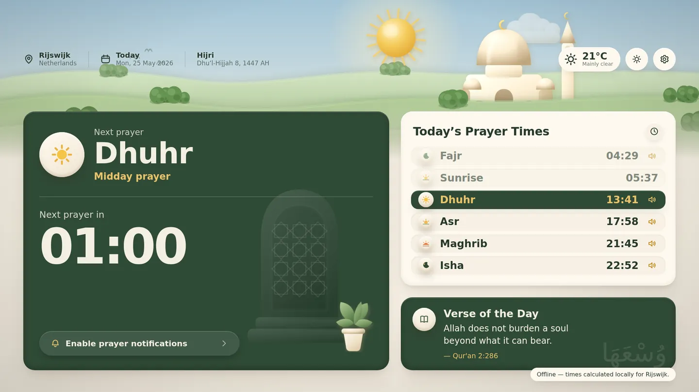
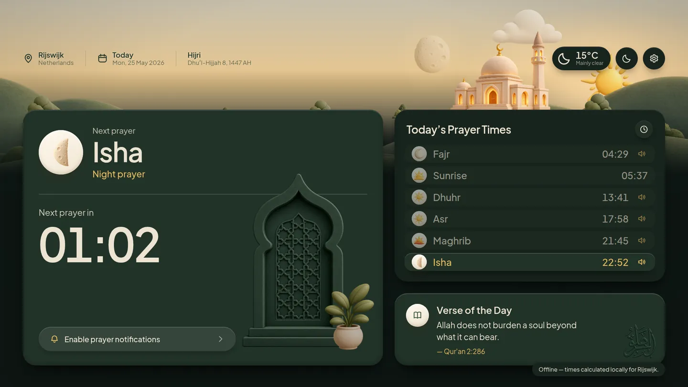
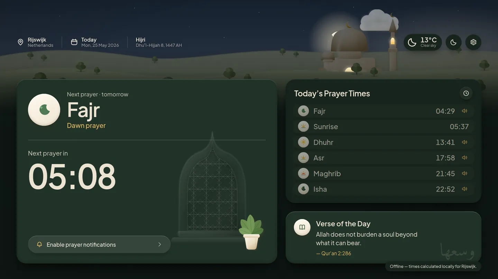
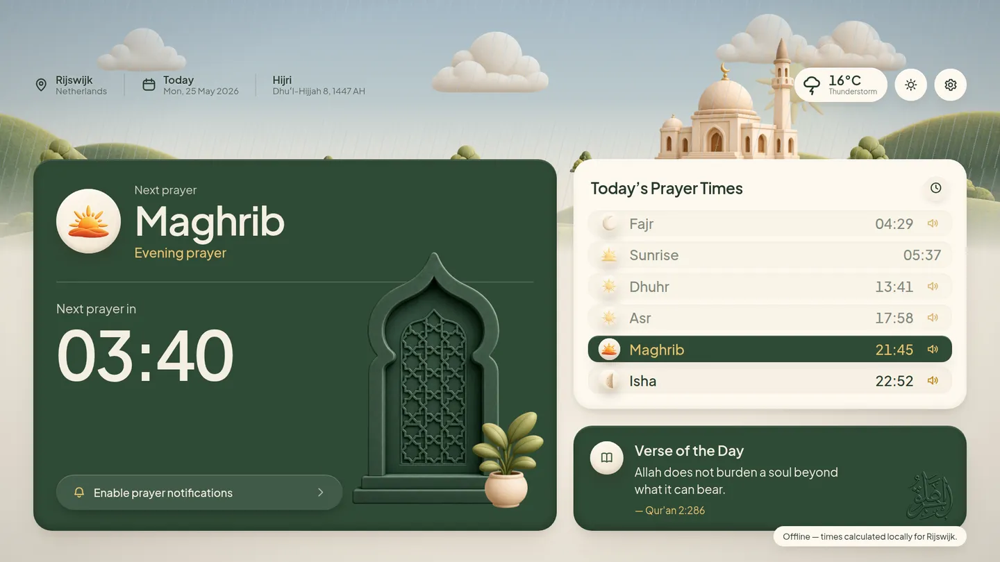
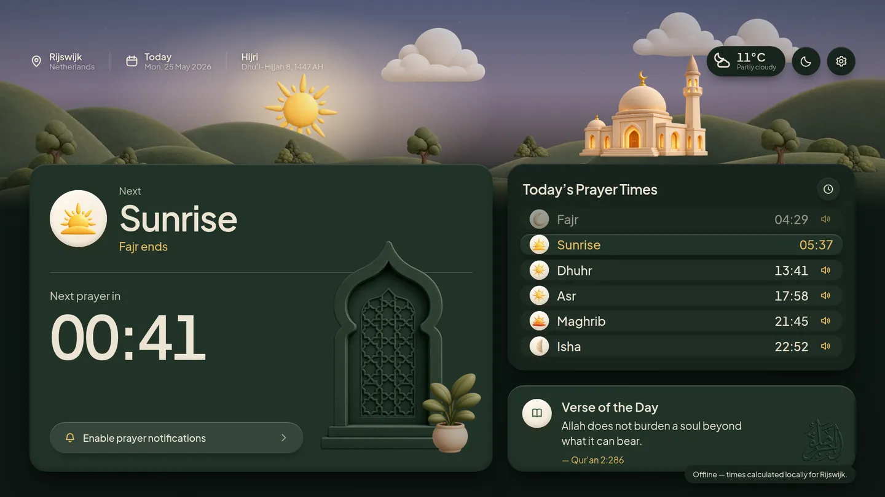

# Prayer Times

A 1920×1080 prayer-times display: today's times and a live countdown to the
next prayer, over a claymorphic landscape that follows the real sun, moon and
weather for the default city.



| | |
| --- | --- |
|  |  |
|  |  |

Built with Next.js (App Router) and no UI framework — the clay look is rendered
art over a small set of CSS custom properties and shadows in `app/globals.css`.
Type is [Plus Jakarta Sans](https://fonts.google.com/specimen/Plus+Jakarta+Sans),
self-hosted from npm so the Docker build never reaches for Google Fonts.

## Running it

```bash
npm install
npm run dev          # http://localhost:3000
```

Add a `DIYANET_API_KEY` (see below) and open the settings drawer to pick a city.
Prayer times need a Diyanet API key; see below.

With Docker:

```bash
docker compose -f docker-compose.standalone.yml up -d --build
```

```bash
npm run build && npm start   # production
npm run typecheck            # tsc --noEmit
npm run scene                # re-render the artwork (see "Artwork")
```

Point a browser at it full-screen on a 16:9 display and it is a wall panel. The
layout is authored at 1920×1080 and scales as one piece to any resolution;
below 1000px wide it stacks into a phone layout. Times are shown on a 24-hour
clock.

## Where the data comes from

| What | Source | Notes |
| --- | --- | --- |
| Prayer times | [Diyanet Prayer Times API](https://diyanetapi.mennova.nl/scalar) `/api/v1/prayer-times/{cityId}/range` | Needs an API key. |
| Daily content | Same API, `/api/v1/daily-content` | Turkish verse, hadith and prayer; any of them can be missing. |
| City search | Same API, `/api/v1/places/cities` and `/places/nearest` | Search by name or by GPS position. |
| Weather | [Open-Meteo](https://open-meteo.com) `/v1/forecast` | Keyless. Current conditions, WMO code. |

Create a key with the scopes `places:read`, `prayer-times:read` and
`daily-content:read`, and put it in `.env.local`:

```bash
cp .env.example .env.local
DIYANET_API_KEY=…
```

The key stays on the server. The browser only calls this app's own `/api`
routes, which add the key and forward the request.

**The calendar is fetched once.** One request asks for today through
today + 365 days and the result is stored in the browser's `localStorage`. The
app reads from that copy and tops it up with a fresh request when fewer than 30
future days remain, or when the city changes. If nothing is cached and the API
cannot be reached, a dialog explains and offers a Reload button.

On first run no city is chosen, so the settings drawer opens on the city search.

The daily content card shows a tab for each of verse, hadith and prayer that
the API returned. With one section it shows a plain title, and with none the
card is removed so the prayer times card takes the whole column.

Optional overrides:

```bash
DIYANET_API_URL=https://diyanetapi.mennova.nl
OPEN_METEO_BASE_URL=https://api.open-meteo.com/v1
```

## Settings

The gear at the top right opens a drawer. Everything is stored in
`localStorage` — there is no account and nothing leaves the browser.

- **Time offsets** — ±60 minutes per prayer. This shifts the displayed time and
  delays the announcement with it, so `+5` on Dhuhr calls it five minutes after
  the calculated time.
- **Announced prayers** — the same switches as the speakers on the rows, for
  when a row is hard to reach on a wall display.
- **Appearance** — light/dark mode, 24-hour clock, weather on or off, and a
  reduce-motion switch that parks the animation.

### Light and dark

The interface turns **dark at Maghrib and light again at sunrise**. That is
deliberately tied to the prayer times, not to the sun's altitude: Maghrib is
the moment the day is over for the people reading the screen.

The toggle beside the gear pins it either way — a ring around the button means
the clock is no longer driving it. "Follow the sun" in the settings drawer
hands it back.

The sky is not part of that switch. It stays a continuous function of the sun's
real altitude, so just after Maghrib you get dark cards under a sky that is
still burning gold. Text that sits directly on the scene (the location and date
row) takes its colour from the sky rather than from the mode, so it stays
readable through that window.

## The call to prayer

The speaker on each prayer row toggles that prayer's announcement;
**shift-click it to hear the tone immediately** without waiting for the time.
When a prayer arrives the screen takes over with the prayer's name and the tone
plays. Browsers refuse to play audio before the page is interacted with, so the
**Enable prayer notifications** button on the countdown card unlocks it — press
it once when you set the display up.

A recording, `public/audio/adhan.mp3`, ships with the app and is used for every
prayer. To change it, replace that file — or add `adhan-fajr.mp3` for a
per-prayer call. It is picked up on the next load with no configuration. When no
recording is present, a tone synthesised in `lib/adhan.ts` (struck-bell partials
arranged in Hijaz) plays instead.

## The scene

`components/scene/SceneBackground.tsx` draws it, and everything in it is
driven by real values rather than a time-of-day preset:

- **Sky** — every sky colour is a continuous function of the sun's altitude
  (`lib/sky.ts`), interpolated between keyframes, so the landscape drifts from
  night through dawn to day with no visible switch. Dawn runs cool and pink,
  dusk runs amber. The interface palette is separate, and switches at Maghrib.
- **Sun and moon** — placed from real altitude and azimuth for the location.
  The moon carries its actual phase, carved out of the disc with a CSS mask.
  Both set behind the hills. The vertical arc is compressed into the strip of
  sky above the cards; the horizontal arc is centred right of screen centre to
  clear the logo.
- **Weather** — the WMO code from Open-Meteo picks cloud density, rain, sleet,
  snow, fog, and the lightning flash, and mutes the palette (`lib/weather.ts`).
  Clouds drift on independent slow loops, and the lower ones swap to the
  raining render when it is wet.

## Artwork

The scene is built from rendered clay art, not vector illustration. Masters live
in `assets/scene/` as trimmed lossless WebP; `public/scene/` holds the display
copies the app actually serves.

```bash
npm run scene    # assets/scene/*.webp -> public/scene/*.webp
```

The build step resizes each master to roughly twice its largest on-screen size
and re-encodes it lossily — 18 layers, about 650 kB in total. The generated
files are committed, so a fresh clone runs without this step; re-run it after
replacing a master.

To swap in your own art, replace the master of the same name and re-run. A few
layers have contracts worth knowing:

- **`mosque-day` / `mosque-night`** are two renders of the same building that
  cross-fade at Maghrib, so the night one carries the lit windows. The build
  pads both onto one frame, bottom aligned on the ground line, or they jump as
  they fade.
- **`arch`, `plant` and `calligraphy`** sit on the deep green card and are
  rendered *in that green*, which is what makes them read as relief rather than
  as stickers. In dark mode they are dimmed by the same amount the card is
  (`--ornament-bright`).
- **`moon-crescent` / `-half` / `-gibbous` / `-full`** are picked by the moon's
  real illuminated fraction. They are lit from the left — a waning moon — so a
  waxing moon is the same art mirrored.
- **`sun-rising` / `sun-setting`** include a mound at the base, which makes them
  icons rather than sky elements: they are the Sunrise and Maghrib row marks.
  `sun-full` is both the sky sun and the Dhuhr/Asr mark.
- **`landscape`** is one band carrying its own depth, with `tree` and `bushes`
  scattered in front of it. A second copy for parallax would read as a repeat of
  the same silhouette.

## Layout

```
app/
  api/prayer-times/   proxy to the Diyanet range endpoint
  api/daily-content/  proxy to the Diyanet daily content endpoint
  api/places/         city search and nearest city
  api/weather/        current conditions, 10-minute memory cache
  api/audio/          lists any adhan recordings you added
  api/health/         liveness probe
  globals.css         clay design system
  scene.css           the background and its animations
components/           header, cards, settings drawer, scene
lib/
  solar.ts            sun/moon position
  sky.ts              altitude → sky; Maghrib → light/dark interface
  prayer.ts           schedule, next prayer, kerahat windows
  time.ts             timezone-correct conversion and formatting
  diyanet-api.ts      server-side client for the Diyanet API
  prayer-cache.ts     fetching and localStorage caching of the yearly calendar
scripts/              the artwork build
```

## Known gaps

- One screen. There is no navigation and no other page.
- Kerahat windows are still computed in `lib/prayer.ts` (`schedule.kerahat`,
  the conventional 45-minute İşrak / İstiva / İsfirar windows) but nothing
  renders them — they are meant to be presented differently.
